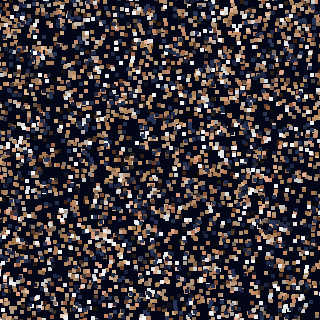
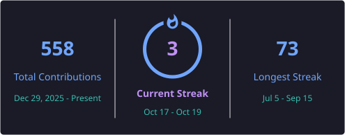
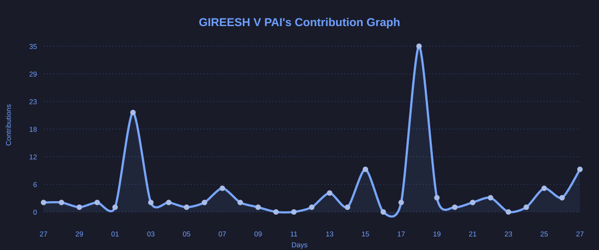
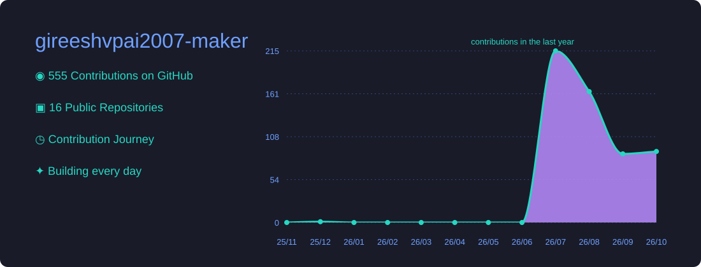

<div align="center">


<br>



<br><br>

<a href="https://github.com/gireeshvpai2007-maker?tab=repositories"></a>

<br><br>


<br><br>


</div>

<picture>
  <source media="(prefers-color-scheme: dark)" srcset="dark_mode.svg?v=20261028130017" />
  <source media="(prefers-color-scheme: light)" srcset="light_mode.svg?v=20261028130017" />
  
</picture>

---

## 👋 Hey, I'm Gireesh

**Computer Science undergraduate at MIT Manipal** interested in building useful software, understanding systems from first principles, and applying AI to real problems.

I enjoy moving between the fundamentals—data structures, algorithms, networking, and digital systems—and projects that put those concepts to work.

```cpp
class Gireesh {
public:
    string role = "Software Engineer in Progress";
    string university = "MIT Manipal";

    vector<string> focus = {
        "Data Structures & Algorithms",
        "AI / ML and Data Analytics",
        "Computer Vision Research",
        "Networking and Systems",
        "Compiler Fundamentals"
    };

    string philosophy =
        "Understand the why. Build the thing. Improve it.";
};
```

## ⚡ What I'm building now

<table>
<tr>
<td width="50%" valign="top">

### 🦿 [MedVision-2D3D](https://github.com/gireeshvpai2007-maker/MedVision-2D3D)
**Medical imaging research**

Exploring a knee-landmark pipeline as part of a research project focused on 2D-to-3D reconstruction.

- 20-landmark heatmap generation
- CNN-based landmark model
- Heatmap decoding and coordinate handling
- Dataset inspection and evaluation foundations


</td>
<td width="50%" valign="top">

### 🌐 [NetForge](https://github.com/gireeshvpai2007-maker/NetForge)
**Networking lab & packet analysis**

A hands-on networking project connecting protocol concepts with real packet-level experiments.

- TCP client/server experiments
- Packet inspection using TShark / Wireshark
- Python-based packet analysis
- Building toward connection tracking and routing concepts


</td>
</tr>
<tr>
<td width="50%" valign="top">

### 📈 [InsightAI](https://github.com/gireeshvpai2007-maker/InsightAI)
**AI-powered business analytics**

Turning tabular data into analysis, visualizations, predictive models, and actionable insights.

- Data cleaning and feature engineering
- Exploratory data analysis
- Regression model evaluation
- Interactive analytics dashboard in progress


</td>
<td width="50%" valign="top">

### 🏏 [T20 Match Analytics & Penalty Engine](https://github.com/gireeshvpai2007-maker/T20_Match_Analytics)
**Verilog digital-systems project**

A modular hardware design for cricket score tracking and live match-display logic.

- Score aggregation and over-rate subtraction
- Target comparison using a ripple-carry subtractor
- Penalty trigger and display multiplexer
- Integrated testbench and waveform-based verification


</td>
</tr>
</table>

---

## 🧩 More projects

<table>
<tr>
<td width="50%" valign="top">

### 🧠 [Amchi](https://github.com/gireeshvpai2007-maker/Amchi)
A C++ language project inspired by GSB Konkani, exploring how programming languages work under the hood.

- Lexer and token system
- Recursive-descent parser
- Abstract Syntax Tree (AST)
- Variables, expressions, precedence
- Conditional statements and output


</td>
<td width="50%" valign="top">

### ☕ [StreamVault](https://github.com/gireeshvpai2007-maker/OOP-Implementation)
A Java media-library and recommendation project built to practice object-oriented design.

- OOP and composition
- Collections, generics, enums
- Java Stream API
- Factory-pattern concepts


</td>
</tr>
<tr>
<td width="50%" valign="top">

### 🚌 [Vishnu Tours & Travels](https://github.com/gireeshvpai2007-maker/Vishnu-Tours-Travels-Website)
A responsive website for a real travel-agency business, with customer enquiry flows.

- Responsive UI and dark mode
- WhatsApp enquiry integration
- Contact form and deployment

🌐 [View live website](https://vishnu-tours-travels.netlify.app)


</td>
<td width="50%" valign="top">

### 📊 [Data Visualisation](https://github.com/gireeshvpai2007-maker/Data-Visualisation)
Python/Jupyter exploration of datasets, including emotion analysis and word-cloud visualization.

<p align="center">

</p>


</td>
</tr>
<tr>
<td width="50%" valign="top">

### 🌳 [Data Structures](https://github.com/gireeshvpai2007-maker/DataStructures)
Implementations and practice focused on core programming and interview fundamentals.

- Arrays, strings, linked lists
- Stacks, queues, recursion
- Binary trees and BSTs
- Searching, sorting, and algorithms


</td>
<td width="50%" valign="top">

### 💻 [freeCodeCamp Projects](https://github.com/gireeshvpai2007-maker/FreeCodeCamp)
Web development projects and exercises completed while learning frontend fundamentals.

- HTML and responsive CSS
- JavaScript challenges
- Responsive website layouts


</td>
</tr>
</table>

---

## 🛠️ Tech stack

<p align="center">
  <strong>LANGUAGES</strong><br><br>
  
</p>

<p align="center">
  <strong>AI · DATA · WEB</strong><br><br>
  
</p>

<p align="center">
  <strong>TOOLS · SYSTEMS · WORKFLOW</strong><br><br>
  <br><br>
  
  
</p>

<p align="center">
  
  
  
</p>

---

## 🧭 Currently learning

- **DSA:** binary trees, BST validation, traversal patterns, complexity analysis, and interview problem-solving
- **Machine learning:** model evaluation, feature engineering, and practical experimentation
- **Computer vision:** landmark heatmaps, coordinate decoding, and model evaluation
- **Computer networks:** TCP connection tracking, packet analysis, and routing protocols
- **Digital systems:** sequential logic and Verilog simulation
- **Language implementation:** parsing, ASTs, and interpreter design

---

## 📊 GitHub analytics

<div align="center">




<br><br>



<br><br>

<h3>Activity over time</h3>


<br><br>

<h3>Contribution journey</h3>


</div>

---

## 🐍 Keep the commits coming

<div align="center">
<picture>
  <source media="(prefers-color-scheme: dark)" srcset="https://raw.githubusercontent.com/gireeshvpai2007-maker/gireeshvpai2007-maker/output/github-contribution-grid-snake-dark.svg"/>
  <source media="(prefers-color-scheme: light)" srcset="https://raw.githubusercontent.com/gireeshvpai2007-maker/gireeshvpai2007-maker/output/github-contribution-grid-snake.svg"/>
  
</picture>

<br><br>

<i>Understand the why. Build the thing. Improve it.</i>

</div>
