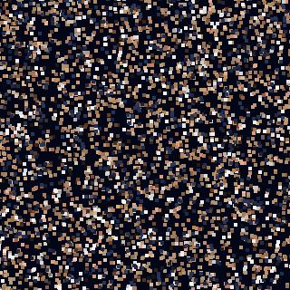
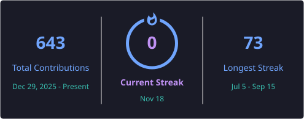
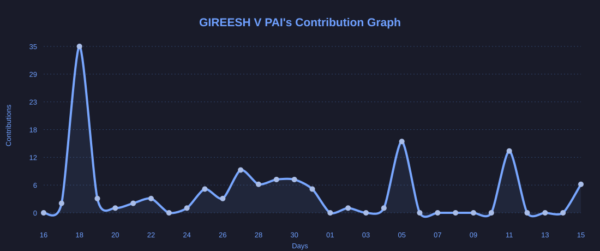
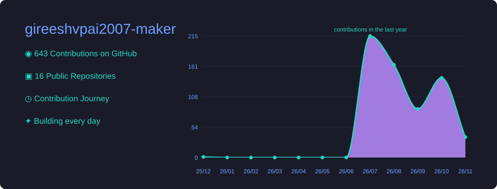

 

  

  
<a href="#about">ABOUT</a> · <a href="#selected-work">SELECTED WORK</a> · <a href="#toolkit">TOOLKIT</a> · <a href="#activity">ACTIVITY</a> · <a href="#contact">CONTACT</a>

<picture>
  <source media="(prefers-color-scheme: dark)" srcset="dark_mode.svg?v=20261115135900"/>
  <source media="(prefers-color-scheme: light)" srcset="light_mode.svg?v=20261115135900"/>
  
</picture>

---

## About

I'm a **Computer Science undergraduate at MIT Manipal** interested in building practical software and understanding the systems behind it.

My work spans AI and data-driven applications, computer vision research, networking, and core software engineering. I enjoy taking an idea from fundamentals to a working implementation—and learning from every iteration.

**Current interests:** Data Structures & Algorithms · AI / ML · Computer Vision · Networking · Systems

> Understand the why. Build the thing. Improve it.

---

## Selected work

A few projects that represent what I'm exploring and building.

<table>
<tr>
<td width="50%" valign="top">

### [MedVision-2D3D](https://github.com/gireeshvpai2007-maker/MedVision-2D3D)

**Computer vision · Research**

Exploring a knee-landmark pipeline for 2D-to-3D reconstruction.

- 20-landmark heatmap generation
- CNN-based landmark model
- Heatmap decoding and coordinate handling
- Dataset inspection and evaluation foundations

</td>
<td width="50%" valign="top">

### [InsightAI](https://github.com/gireeshvpai2007-maker/InsightAI)

**AI · Business analytics**

An analytics prototype that turns tabular data into exploration, predictive modelling, and actionable insights.

- Data preprocessing and EDA
- Regression model comparison
- Streamlit analytics dashboard
- House-price experiment: R² 0.8993, MAPE 5.31%

</td>
</tr>
<tr>
<td width="50%" valign="top">

### [NetForge](https://github.com/gireeshvpai2007-maker/NetForge)

**Computer networks · Packet analysis**

Hands-on networking experiments connecting protocol concepts with packet-level analysis.

- TCP client/server experiments
- TShark / Wireshark inspection
- Python packet analysis
- Connection tracking foundations

</td>
<td width="50%" valign="top">

### [T20 Match Analytics](https://github.com/gireeshvpai2007-maker/T20_Match_Analytics)

**Digital systems · Verilog**

A modular hardware design for cricket score tracking and match-display logic.

- Score aggregation and over-rate subtraction
- Target comparison using a ripple-carry subtractor
- Penalty trigger and display multiplexer
- Testbench and waveform-based verification

</td>
</tr>
</table>

### More projects

| Project | What it explores |
|---|---|
| [Amchi](https://github.com/gireeshvpai2007-maker/Amchi) | A C++ language project inspired by GSB Konkani: lexer, parser, AST, expressions and control flow. |
| [StreamVault](https://github.com/gireeshvpai2007-maker/OOP-Implementation) | Java media-library project exploring OOP, collections, generics, streams and design patterns. |
| [Vishnu Tours & Travels](https://github.com/gireeshvpai2007-maker/Vishnu-Tours-Travels-Website) | Responsive website for a family travel agency, with enquiry flows and WhatsApp integration. [Live site](https://vishnu-tours-travels.netlify.app) |
| [Data Visualisation](https://github.com/gireeshvpai2007-maker/Data-Visualisation) | Python/Jupyter data exploration, including emotion analysis and word-cloud visualization. |
| [Data Structures](https://github.com/gireeshvpai2007-maker/DataStructures) | Implementations and practice covering linked lists, stacks, queues, trees, searching and sorting. |
| [freeCodeCamp Projects](https://github.com/gireeshvpai2007-maker/FreeCodeCamp) | Frontend learning projects in HTML, responsive CSS and JavaScript. |

---

## Toolkit

**LANGUAGES**

**AI · DATA · WEB**

**TOOLS · SYSTEMS**

 

---

## Current learning

- **Algorithms:** tree structures, traversal, problem-solving patterns and complexity analysis
- **Machine learning:** feature engineering, model evaluation and experimentation
- **Computer vision:** landmark heatmaps and coordinate decoding
- **Systems:** TCP connection tracking, sequential logic and Verilog simulation
- **Language implementation:** parsing, syntax trees and compiler fundamentals

---

## Activity

 

  

  

  

---

## Contribution trail

<picture>
  <source media="(prefers-color-scheme: dark)" srcset="https://raw.githubusercontent.com/gireeshvpai2007-maker/gireeshvpai2007-maker/output/github-contribution-grid-snake-dark.svg"/>
  <source media="(prefers-color-scheme: light)" srcset="https://raw.githubusercontent.com/gireeshvpai2007-maker/gireeshvpai2007-maker/output/github-contribution-grid-snake.svg"/>
  
</picture>

---

## Contact

Interested in collaborating on thoughtful software, AI/ML, data analytics, computer vision, and systems projects.

  
MIT Manipal · Computer Science

